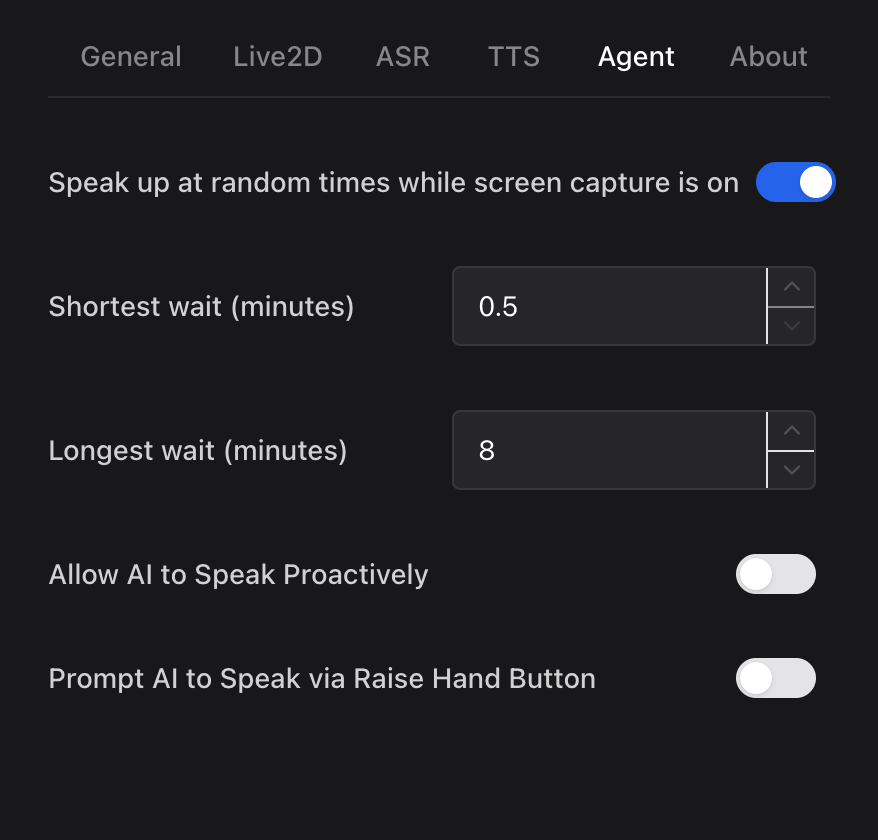
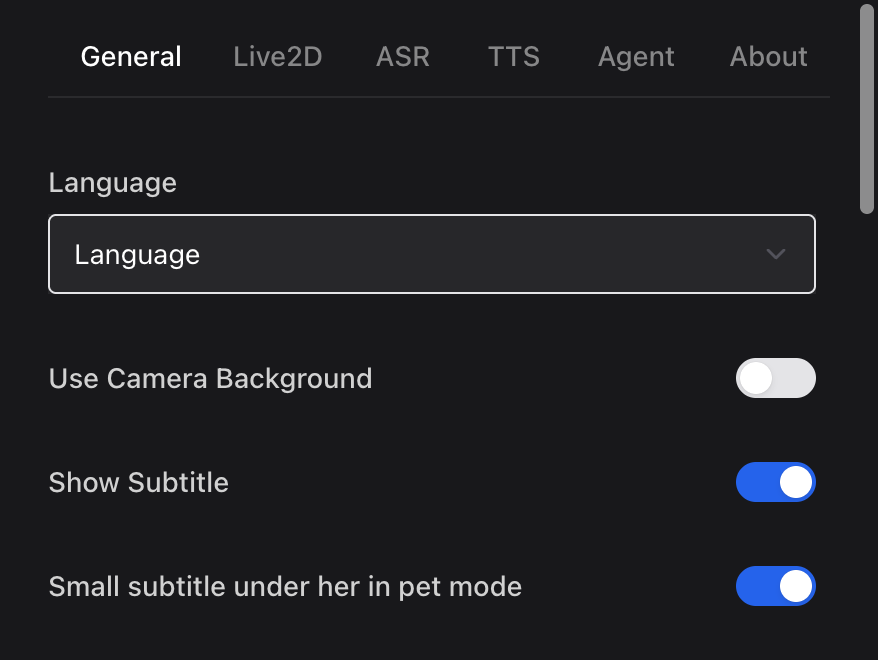

# Miku desktop pet (Open-LLM-VTuber mod)

A desktop companion that lives on your Mac: she sees your screen, speaks up on her own at random
times, chats with you in casual Japanese (with readings and English, for Japanese learners), and
keeps her memory when you switch AI providers.

This is a fork of [Open-LLM-VTuber](https://github.com/Open-LLM-VTuber/Open-LLM-VTuber) by
Yi-Ting Chiu and the Open-LLM-VTuber contributors. All credit for the app goes to them; this fork
only adds the changes listed below. The desktop app changes live in the companion fork
[HongButNotY/Open-LLM-VTuber-Web](https://github.com/HongButNotY/Open-LLM-VTuber-Web/tree/miku-desktop-pet).

## What this fork adds

Server (this repo):
- **Switch AI without losing memory**: choose `grok`, `deepseek` or `claude` in `keys.env`; chat history
  is kept per character, not per provider.
- **Cheaper requests**: only the last `MAX_MEMORY_MESSAGES` messages are sent (full history stays on disk);
  `LLM_VISION=false` skips screenshots for models that can't read images (set automatically for DeepSeek).
- **VOICEVOX voice engine** (`tts_model: 'voicevox_tts'`), plus pitch/rate options for Edge TTS.
- **Miku persona**: a cheerful companion who talks in casual Japanese with kana readings and English.
- **Miku model patch**: 9 mood expressions and body-only idle motions for Live2D's official Miku sample.

Desktop app ([companion fork](https://github.com/HongButNotY/Open-LLM-VTuber-Web/tree/miku-desktop-pet)):
- **Speaks up on her own at random times** (30 s to 8 min) while screen capture is on, with a fresh screenshot each time.
- **Small subtitle under her in pet mode**, following her when dragged (toggle in Settings → General).
- **Voice volume, mic on/off at startup, and a saved pet-mode size** (Settings → General and ASR; scrolling on her in pet mode saves her size).
- **Reliable pet-mode click-through**: clicks pass through empty space but not her or open panels.
  "Click Through Everything" (tray or right-click menu) can be switched off with ⌥⇧⌘M.
- **Electron 45**: the prebuilt v1.2.1 app (Electron 31) is blocked by macOS as "malware" because Apple
  revoked that Electron runtime; building on Electron 45 fixes it.




## Setup (macOS)

You need [uv](https://docs.astral.sh/uv/), ffmpeg and 7-Zip (e.g. `brew install ffmpeg sevenzip`).

1. Clone this fork on the `miku-desktop-pet` branch and run the setup script:
   ```bash
   git clone -b miku-desktop-pet --recursive https://github.com/HongButNotY/Open-LLM-VTuber.git
   cd Open-LLM-VTuber
   zsh scripts/miku/setup_miku.sh
   ```
   It downloads Live2D's official Miku sample (it asks you to agree to the terms first) and the VOICEVOX
   engine (about 1.7 GB, checksum-verified), then creates `conf.yaml` and `keys.env`.
2. Put your API key in `keys.env` and choose `PROVIDER=` (`grok`, `deepseek` or `claude`).
3. Build the desktop app from the companion fork (needs Node.js 22):
   ```bash
   git clone -b miku-desktop-pet https://github.com/HongButNotY/Open-LLM-VTuber-Web.git
   cd Open-LLM-VTuber-Web
   npm ci
   npm run build && CSC_IDENTITY_AUTO_DISCOVERY=false npx electron-builder --mac dir
   ```
   Copy `release/1.2.1/mac-*/open-llm-vtuber-electron.app` to Applications.
4. Double-click `start_miku.command` (starts the voice engine and the server), open the app,
   switch to Pet mode and turn on Screen capture.

To use Microsoft's Edge voice instead of VOICEVOX, set `tts_model: 'edge_tts'` in `conf.yaml` and run
`uv pip install -U edge-tts` (the locked version is rejected by Microsoft's service).

## Credits and licenses

- **Open-LLM-VTuber** (server): MIT License, © 2025 Yi-Ting Chiu. See [LICENSE](LICENSE).
- **Open-LLM-VTuber-Web** (desktop app): Open-LLM-VTuber License 1.0, © 2025 Open LLM Vtuber
  (Apache 2.0 with additional conditions; free for non-commercial use).
- **Hatsune Miku Live2D model**: Live2D Cubism sample data, illustration © Crypton Future Media, INC.
  www.piapro.net, modeling by Live2D Inc. Not included in this repo (Live2D's terms do not allow
  redistribution); the setup script downloads it from Live2D. Use it under the
  [Live2D sample terms](https://www.live2d.com/en/learn/sample/hatsune-miku/) and the
  [Piapro Character License](https://piapro.jp/license/pcl/summary): personal, non-commercial use.
  The expressions in `scripts/miku/expressions/` were written for this fork.
- **Voice**: VOICEVOX:春日部つむぎ, via [VOICEVOX](https://voicevox.hiroshiba.jp/). Credit
  `VOICEVOX:春日部つむぎ` when sharing audio ([terms](https://tsumugi-official.studio.site/rule)).
  The engine is downloaded from [VOICEVOX's releases](https://github.com/VOICEVOX/voicevox_engine/releases),
  not included here.

Changes in this fork were made with help from Claude Code.
